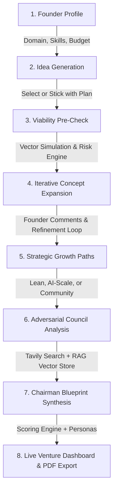
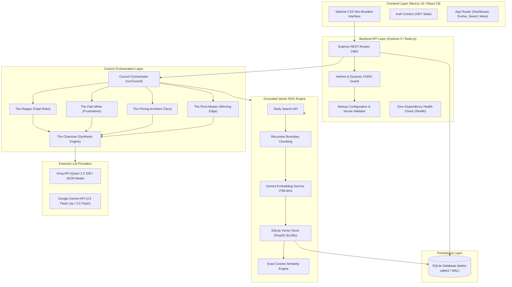
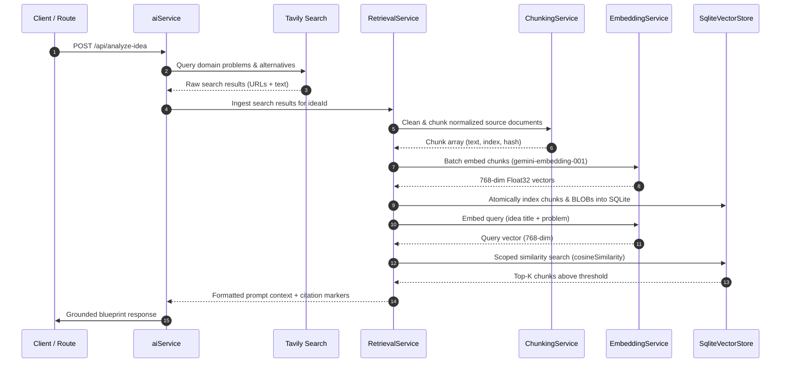
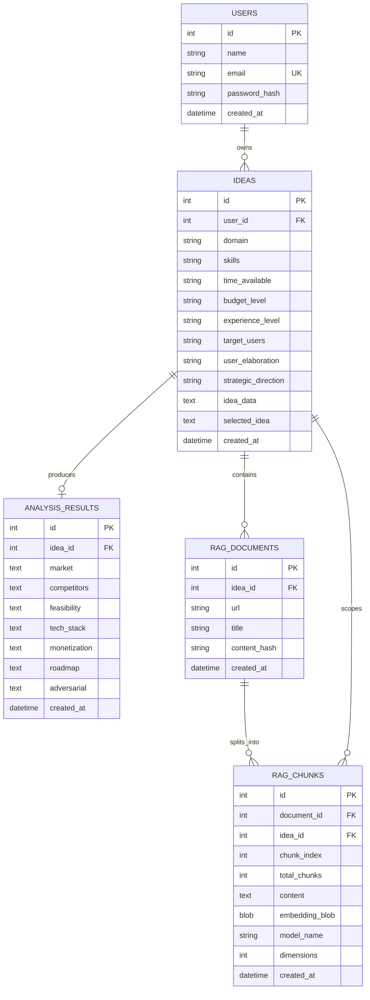

<div align="center">
  <h1>Upstart Agentic V2</h1>
  <p><strong>Autonomous Multi-Agent Venture Incubator, Grounded RAG Research Engine, and Comparative Evaluation System</strong></p>

  <p>
    <a href="https://upstart-agentic-v2.vercel.app/" target="_blank"><strong>🌐 Live Web Application (Vercel)</strong></a> •
    <a href="https://upstart-backend-2uig.onrender.com/health" target="_blank"><strong>⚡ Live Backend API (Render)</strong></a> •
    <a href="https://github.com/LakshayChakravarti/upstart-agentic-v2" target="_blank"><strong>📁 GitHub Repository</strong></a>
  </p>

  <p>
    
    
    
    
    
    
    
  </p>
</div>

> [!NOTE]
> **Live Deployment Notice & Cold Starts**
> The live backend is hosted on Render's free tier (`https://upstart-backend-2uig.onrender.com`). Render automatically spins down free instances after 15 minutes of inactivity. The initial request or login after a dormant period may experience a **30 to 50-second cold start** while the container provisions. Subsequent interactions respond with normal sub-second latency. The database on this free deployment operates on an ephemeral local filesystem.

---

## Table of Contents

- [1. Executive Overview](#1-executive-overview)
- [2. End-to-End User Journey](#2-end-to-end-user-journey)
- [3. System Architecture](#3-system-architecture)
- [4. Multi-Agent Council Architecture](#4-multi-agent-council-architecture)
  - [Specialist Personas](#specialist-personas)
  - [Chairman Synthesis & Verification](#chairman-synthesis--verification)
  - [Resilience & Fallback Strategy](#resilience--fallback-strategy)
- [5. Grounded Vector RAG Pipeline](#5-grounded-vector-rag-pipeline)
  - [Search Ingestion & Normalization](#search-ingestion--normalization)
  - [Recursive Overlapping Chunking](#recursive-overlapping-chunking)
  - [Vector Embeddings & Strict Validation](#vector-embeddings--strict-validation)
  - [Transactional SQLite Vector Store](#transactional-sqlite-vector-store)
  - [Context Formulation & Fallback Hierarchy](#context-formulation--fallback-hierarchy)
- [6. Multi-Provider LLM Resilience](#6-multi-provider-llm-resilience)
- [7. Backend Architecture & REST API](#7-backend-architecture--rest-api)
- [8. Database Persistence & Data Models](#8-database-persistence--data-models)
- [9. Frontend Architecture & Design](#9-frontend-architecture--design)
- [10. Comparative Evaluation Framework](#10-comparative-evaluation-framework)
- [11. Local Installation & Development](#11-local-installation--development)
- [12. Environment Variable Reference](#12-environment-variable-reference)
- [13. Deployment Architecture](#13-deployment-architecture)
- [14. Known Limitations & Roadmap](#14-known-limitations--roadmap)

---

## 1. Executive Overview

Most founders, hackathon participants, and student engineers build startups based on superficial intuition rather than validated market pain points. Traditional AI brainstormers produce optimistic, ungrounded concepts that ignore regulatory constraints, unit economics, and existing market competitors.

**Upstart Agentic V2** is an autonomous venture acceleration engine. Rather than relying on a single, naive text prompt, Upstart coordinates an **adversarial council of four specialist AI personas**, backed by a **domain-scoped vector retrieval-augmented generation (RAG) pipeline** querying live web intelligence via Tavily.

The system subjects every startup concept to ruthless scrutiny, excavates real customer frustrations, constructs unit-economic pricing tiers, engineers a defensive competitive moat, and synthesizes a production-grade venture blueprint with an evidence-grounded feasibility score.

```
┌───────────────────────────────────────────────────────────────────────────┐
│                        UPSTART AGENTIC V2 ENGINE                          │
├──────────────────┬──────────────────────┬─────────────────────────────────┤
│ Adversarial      │ Domain-Scoped RAG    │ Resilient Execution             │
│ Council of Four  │ 768-dim embeddings   │ Multi-tier fallback across Groq │
│ Specialist LLMs  │ in SQLite via cosine │ & Gemini with strict JSON       │
│ & Chairman       │ similarity retrieval │ validation & health checks      │
└──────────────────┴──────────────────────┴─────────────────────────────────┘
```

---

## 2. End-to-End User Journey



1. **Founder Profile Intake**: The user provides domain interest, skills, available weekly hours, budget bracket (or exact custom capital), experience tier, and target demographics.
2. **AI Idea Generation**: The platform generates 3 tailored concepts or allows the founder to input their own original thesis directly.
3. **Pre-Flight Viability Check**: The concept is cross-referenced against historical company failure modes and evaluated across initial regulatory, technical, and market risk dimensions.
4. **Iterative Concept Expansion**: The founder inspects problem-solution mechanics, target personas, revenue models, and budget allocations. Founders can submit natural-language feedback in an iterative refinement loop.
5. **Strategic Growth Paths**: The user selects one of three strategic trajectories (e.g., Lean Bootstrap, AI-First Platform, or Community-Led Distribution).
6. **Live Council Analysis & Research Retrieval**: Upstart queries live market intelligence via Tavily, ingests and chunks documents, embeds them via Google Gemini, indexes chunks into SQLite, and parallel-dispatches the 4 adversarial Council agents.
7. **Chairman Synthesis**: The Chairman agent reconciles persona assessments against grounded citations, calculates a 5-pillar feasibility score, and outputs a complete venture blueprint.
8. **Interactive Blueprint Dashboard & PDF Export**: Results are rendered via a Neo-Brutalist interface, persisted to SQLite, and exportable to clean print-ready PDF dossiers.

---

## 3. System Architecture



---

## 4. Multi-Agent Council Architecture

Rather than prompting a monolithic LLM to write a business plan, Upstart decomposes venture assessment into four specialized adversarial agents executed in parallel, followed by a Chairman synthesis stage.

### Specialist Personas

```
┌───────────────────┬──────────────────────────────────┬─────────────────────────────┐
│ Persona           │ Core Mission                     │ Output Target               │
├───────────────────┼──────────────────────────────────┼─────────────────────────────┤
│ The Reaper        │ Uncompromising vulnerability     │ Array<{ point: string }>    │
│                   │ analysis: identifies 3 fatal     │ (Market, technical, and     │
│                   │ flaws, distribution traps, or moats. │ execution failure modes)│
├───────────────────┼──────────────────────────────────┼─────────────────────────────┤
│ The Pain Miner    │ Customer insight excavation:     │ Array<{ frustration: str }> │
│                   │ extracts 3 real, documented      │ (Real customer friction and │
│                   │ workflow frictions from sources. │ unaddressed pain points)    │
├───────────────────┼──────────────────────────────────┼─────────────────────────────┤
│ The Pricing       │ Unit-economic structuring:       │ Starter, Pro, Enterprise    │
│ Architect         │ builds 3 commercially viable     │ tiers with price points,    │
│                   │ subscription or usage tiers.     │ features, and target buyers │
├───────────────────┼──────────────────────────────────┼─────────────────────────────┤
│ The Pivot Master  │ Asymmetric strategic leverage:   │ { winningEdge: string }     │
│                   │ identifies 1 defensible wedge or │ (High-margin niche or       │
│                   │ unconventional pivot angle.      │ unfair distribution wedge)  │
└───────────────────┴──────────────────────────────────┴─────────────────────────────┘
```

### Chairman Synthesis & Verification

The Chairman agent receives:
1. The original founder thesis and operational parameters (budget, skills, time).
2. The retrieved RAG market research context and source citations.
3. The independently validated JSON outputs from all four Council personas.

The Chairman performs reconciliation:
- Evaluates whether The Reaper's identified risks invalidate The Pivot Master's proposed wedge.
- Checks whether The Pricing Architect's tiers are aligned with The Pain Miner's target buyer.
- Formulates a 5-pillar quantitative feasibility score (Technical, Market, Regulatory, Competitive, Execution).
- Synthesizes the unified VC-grade blueprint schema.

### Resilience & Fallback Strategy

The council orchestrator (`backend/services/councilOrchestrator.js`) enforces strict isolation:
- Individual persona failures trigger custom `CouncilPersonaError` instances with sanitized error messages (redacting API keys and bearer tokens).
- If any specialist persona or the Chairman synthesis fails, the system automatically falls back to single-call unified blueprint generation in `backend/services/aiService.js`, logging explicit diagnostic telemetry.
- Blueprint generation never crashes the user session due to a downstream model provider timeout or malformed JSON output.

---

## 5. Grounded Vector RAG Pipeline

Upstart implements an in-process, production-safe Retrieval-Augmented Generation (RAG) pipeline backed by SQLite.



### Search Ingestion & Normalization
- Queries Tavily using query formulation: `troubleshooting or complaints or competitors for: {title} {problem} site:reddit.com OR alternatives`.
- Normalizes and deduplicates incoming URLs (stripping query parameters and trailing slashes).
- Normalizes character encoding, strips HTML/script tags, and computes SHA-256 content hashes to avoid redundant processing.

### Recursive Overlapping Chunking
- Located in [backend/services/rag/chunkingService.js](file:///c:/Users/laksh/Documents/Projects/upstart-agentic-v2/backend/services/rag/chunkingService.js).
- Splits documents into bounded segments (default: 500 characters, overlap: 100 characters).
- Enforces boundary preservation (splitting on paragraphs `\n\n`, then sentences `\. `, then spaces) to avoid fragmenting semantic clauses.
- Guarantees zero dropped text and monotonic forward progress.

### Vector Embeddings & Strict Validation
- Located in [backend/services/rag/embeddingService.js](file:///c:/Users/laksh/Documents/Projects/upstart-agentic-v2/backend/services/rag/embeddingService.js).
- Consumes Google Gemini's `gemini-embedding-001` model generating **768-dimensional Float32 vectors**.
- Implements `validateVector()`: verifies exact dimension count (768), ensures all elements are finite Float32 numbers (no `NaN`, `Infinity`, or exponent overflows), and chunks embedding requests in native batches of 16 with exponential backoff.

### Transactional SQLite Vector Store
- Located in [backend/services/rag/sqliteVectorStore.js](file:///c:/Users/laksh/Documents/Projects/upstart-agentic-v2/backend/services/rag/sqliteVectorStore.js).
- Serializes `Float32Array` buffers directly into SQLite `BLOB` columns with 4-byte word boundary alignment.
- Performs exact **cosine similarity**:
  $$\text{sim}(\mathbf{u}, \mathbf{v}) = \frac{\mathbf{u} \cdot \mathbf{v}}{\|\mathbf{u}\|_2 \|\mathbf{v}\|_2}$$
- Enforces strict idea session isolation: queries only search chunks mapped to the active `idea_id`.
- Atomic re-indexing: replacing or refreshing research operates inside an explicit SQLite transaction, preventing partial indexing or corrupted states on error.

### Context Formulation & Fallback Hierarchy
1. **Tier 1 (Grounded RAG)**: Chunks meeting the similarity threshold (default: 0.35) are formatted with citation tags `[Source: URL]` and passed into prompts with `ragGrounded: true`.
2. **Tier 2 (Unfiltered Tavily Fallback)**: If vector retrieval returns no chunks above threshold, the system falls back to raw search snippets with an explicit `ragDiagnostics: { status: 'fallback', reason: 'NO_CHUNKS_ABOVE_THRESHOLD' }` tag.
3. **Tier 3 (First-Principles Fallback)**: If search is unavailable or fails, prompts instruct the Council to operate on foundational first-principles reasoning without hallucinating fake citations.

---

## 6. Multi-Provider LLM Resilience

Upstart implements resilient multi-model failover chains designed to operate reliably under strict rate limits and intermittent provider downtime.

```
┌─────────────────────────────────────────────────────────────────────────────┐
│                        AI SERVICE DISPATCH HIERARCHY                        │
├─────────────────────────────────────────────────────────────────────────────┤
│ 1. Groq Gateway (Ultra-Fast Structured Inference)                           │
│    ├── Primary:    qwen/qwen3.8-27b (Confirmed json_object mode, ~250ms)   │
│    ├── Fallback 1: openai/gpt-oss-120b (Fast-fails on HTTP 400)             │
│    └── Fallback 2: openai/gpt-oss-20b                                       │
│                                                                             │
│ 2. Failover to Google Gemini Gateway                                        │
│    ├── Primary:    gemini-3.5-flash-lite (Confirmed stable, ~1.5s latency)  │
│    └── Fallback 1: gemini-3.5-flash (Thinking model; maxOutputTokens: 16k)  │
└─────────────────────────────────────────────────────────────────────────────┘
```

- **Fast-Fail on Non-Retryable HTTP Statuses**: Status codes `400`, `401`, `403`, `404`, and `422` immediately bypass timeouts and transition to the next model in the priority chain.
- **AbortController Timeouts**: Outgoing network requests enforce strict 30-second model timeouts and a 120-second server-level connection cap.
- **Robust JSON Normalization**: Model responses wrapped in markdown code fences (````json ... ````) or surrounded by conversational padding are dynamically extracted and validated.

---

## 7. Backend Architecture & REST API

The backend is built with Express 5, Node.js, Helmet, and CORS.

### Public & Authentication Endpoints

| Method | Endpoint | Auth | Description |
|---|---|:---:|---|
| `GET` | `/health` | No | Zero-dependency health check endpoint returning HTTP 200 `{ status: "ok" }`. |
| `POST` | `/api/auth/signup` | No | Creates a user account with bcrypt-hashed passwords (10 salt rounds). |
| `POST` | `/api/auth/login` | No | Authenticates credentials and returns a signed JWT. |
| `GET` | `/api/auth/me` | Yes | Returns the authenticated user session profile. |

### Idea Evolution & Analysis Endpoints

| Method | Endpoint | Auth | Description |
|---|---|:---:|---|
| `POST` | `/api/generate-ideas` | Yes | Generates 3 initial concepts and initializes a persistent idea session. |
| `POST` | `/api/check-idea-viability` | Yes | Evaluates failure similarity and performs friction analysis. |
| `POST` | `/api/expand-idea` | Yes | Expands a concept into a 10-point specification with iterative founder comments. |
| `POST` | `/api/strategic-directions` | Yes | Generates 3 divergent strategic growth trajectories. |
| `POST` | `/api/analyze-idea` | Yes | Executes Tavily research, RAG vector indexing, Council execution, and blueprint synthesis. Accepts optional `{ useCouncil: boolean }`. |
| `POST` | `/api/save-idea` | Yes | Flags an existing idea session as saved to the user account. |
| `GET` | `/api/ideas` | Yes | Lists all saved ideas for the authenticated user. |
| `GET` | `/api/ideas/:id` | Yes | Reconstitutes full blueprint, persona outputs, and sources for a single idea. |
| `DELETE` | `/api/ideas/:id` | Yes | Cascades deletion of an idea, analysis results, and indexed RAG chunks. |

---

## 8. Database Persistence & Data Models

Upstart utilizes SQLite via `better-sqlite3` with Write-Ahead Logging (`WAL` mode) and foreign key cascades enabled.



- **Single Initialization Vector**: All backend services consume the singleton [backend/db/database.js](file:///c:/Users/laksh/Documents/Projects/upstart-agentic-v2/backend/db/database.js).
- **Filesystem Safety**: Parent directories are recursively verified and created (`fs.mkdirSync(dbDir, { recursive: true })`) before opening the database file.
- **Index Optimization**: Explicit indexes on `rag_chunks(idea_id)` and `rag_chunks(document_id)` guarantee sub-millisecond scoped vector lookups.

---

## 9. Frontend Architecture & Design

Built with **Next.js 16** (App Router) and **React 19**, the user interface uses a high-contrast **Neo-Brutalist design language**: bold black borders (`var(--border-width)`), vibrant accent palettes, offset box shadows (`var(--shadow-color)`), and dynamic typography powered by `next/font/google` (`Inter`).

```
frontend/src/
├── app/
│   ├── layout.tsx         # Root layout with font injection & Navbar
│   ├── page.tsx           # High-converting landing page & interactive walkthrough
│   ├── login/page.tsx     # Secure authentication portal
│   ├── signup/page.tsx    # Registration portal
│   ├── generate/page.tsx  # Multi-parameter founder profile intake form
│   ├── ideas/page.tsx     # 3-card idea selector with custom thesis bypass
│   ├── evolve/page.tsx    # Multi-stage iterative evolution (Viability, Expansion, Strategy)
│   ├── dashboard/page.tsx # Full venture blueprint preview with adversarial persona breakdown
│   ├── saved/page.tsx     # Saved venture repository list
│   └── saved/[id]/        # Individual saved blueprint viewer with print-to-PDF support
├── components/            # Reusable components (Navbar, UI controls)
├── context/               # Global AuthContext managing JWT tokens & session storage
└── lib/api.ts             # Strongly typed API client with AbortController timeouts
```

- **Mobile Responsive Design**: Implements `.blueprint-grid` responsive stacking via `@media (max-width: 768px)` ensuring two-column adversarial persona grids stack into clean single-column layouts on mobile devices.
- **Robust Error Narrowing**: All catch clauses enforce strict `catch (err: unknown)` narrowing with `err instanceof Error` type guards.
- **Zero Lint Violations**: Passes strict ESLint checks with zero global suppressions or disabled rules.

---

## 10. Comparative Evaluation Framework

To empirically evaluate the quality improvement of the 4-persona Council architecture over standard single-call generation, Upstart includes an offline, deterministic evaluation framework in `backend/services/evaluation/`.

```
backend/services/evaluation/
├── benchmarkDataset.js  # 12 diverse synthetic venture benchmark cases (v2.0.0)
├── qualityRubric.js     # 7-dimension evaluation rubric with evidence criteria
├── evaluationRunner.js  # Comparative runner assessing council vs single-call
└── index.js             # Public programmatic evaluation entry point
```

> [!NOTE]
> **Synthetic Benchmark & Directional Evidence**
> The 12-case evaluation suite is an offline synthetic benchmark designed for architectural comparison, regression testing, and quality rubric scoring. Its results provide **directional comparative evidence** demonstrating persona specialization, evidence grounding, and depth of analysis rather than conclusive or statistical proof of commercial startup success.

### The 7 Quality Dimensions

1. **Completeness**: Blueprints must populate all required strategic fields with sufficient volume.
2. **Problem Specificity**: Rewards concrete workflow friction and named user personas over generic platitudes.
3. **Commercial Reasoning**: Evaluates pricing viability, buyer profile alignment, and willingness-to-pay logic.
4. **Risk and Feasibility**: Assesses severity and credibility of technical, market, and execution risks.
5. **Distinct Analytical Value**: Measures the degree of specialization and unique perspective across persona outputs.
6. **Evidence Grounding**: Evaluates the utilization of retrieved RAG sources and explicit citation attribution.
7. **Internal Consistency**: Cross-checks quantitative sub-scores against qualitative narrative severity.

---

## 11. Local Installation & Development

### Prerequisites

- **Node.js**: `v18.0.0` or higher
- **npm**: `v9.0.0` or higher
- API Keys for **Groq**, **Google Gemini**, and **Tavily** (optional for mock tests, required for live generation).

### 1. Clone the Repository

```bash
git clone https://github.com/LakshayChakravarti/upstart-agentic-v2.git
cd upstart-agentic-v2
```

### 2. Configure Environment Files

Create `backend/.env`:
```bash
cp backend/.env.example backend/.env
```
*(Populate your API keys inside `backend/.env`)*

Create `frontend/.env.local`:
```bash
cp frontend/.env.example frontend/.env.local
```

### 3. Install Dependencies

Using root monorepo scripts:
```bash
# Install backend dependencies
npm install --prefix backend

# Install frontend dependencies
npm install --prefix frontend
```

### 4. Run Development Servers

In two separate terminal sessions:

```bash
# Terminal 1: Backend API (runs on http://localhost:5000 with --watch)
npm run dev:backend

# Terminal 2: Frontend App (runs on http://localhost:3000)
npm run dev:frontend
```

Open `http://localhost:3000` in your browser.

---

## 12. Environment Variable Reference

> [!IMPORTANT]
> Never commit `.env` files or expose API credentials. Configure environment variables in deployment provider dashboards (Render / Vercel).

### Backend (`backend/.env`)

| Variable Name | Required | Default / Example | Purpose |
|---|:---:|---|---|
| `PORT` | Optional | `5000` | Port for the Express HTTP server (injected automatically on Render). |
| `NODE_ENV` | Optional | `development` | Set to `production` in live deployments to trigger strict security guards. |
| `DATABASE_PATH` | Optional | `backend/data/upstart.db` | Filesystem path for the SQLite database. Set to `./data/upstart.db` on Render. |
| `JWT_SECRET` | **Required** | *Random 64-char hex* | Secret key for signing and verifying JWT tokens. Fails fast in production if default is used. |
| `FRONTEND_URL` | **Required** | `http://localhost:3000` | Authorized origin for CORS policy. Must match frontend URL in production without trailing slash. |
| `GROQ_API_KEY` | **Required** | `gsk_...` | API key for Groq inference (runs primary idea generation & strategic evolution). |
| `GEMINI_API_KEY` | **Required** | `AIza...` | API key for Google Gemini (runs embeddings and Council blueprint generation). |
| `TAVILY_API_KEY` | Optional | `tvly-...` | API key for Tavily search. If omitted, pipeline operates in first-principles fallback mode. |
| `USE_COUNCIL` | Optional | `true` | Feature flag: set to `true` to invoke the 4-persona Council; `false` runs single-call. |
| `EMBEDDING_MODEL`| Optional | `gemini-embedding-001` | Embedding model identifier for vector generation. |
| `EMBEDDING_DIMENSIONS` | Optional | `768` | Vector dimension count expected by validation routines. |

### Frontend (`frontend/.env.local`)

| Variable Name | Required | Default / Example | Purpose |
|---|:---:|---|---|
| `NEXT_PUBLIC_API_URL` | **Required** | `http://localhost:5000` | Base URL for backend REST API calls without a trailing slash. |

---

## 13. Deployment Architecture

```
┌─────────────────────────────────────────────────────────────────────────────┐
│                           PRODUCTION TOPOLOGY                               │
├──────────────────────────────────────┬──────────────────────────────────────┤
│ Frontend (Vercel)                    │ Backend (Render Free Web Service)    │
│ • Next.js 16 App Router              │ • Node.js / Express REST API         │
│ • Root Directory: frontend           │ • Root Directory: backend            │
│ • Build: next build                  │ • Start: node server.js              │
│ • Domain: upstart-agentic-v2.vercel.app│ • Domain: upstart-backend-2uig.onrender.com │
│ • Env: NEXT_PUBLIC_API_URL           │ • Health: GET /health                │
│                                      │ • Storage: Ephemeral SQLite          │
└──────────────────────────────────────┴──────────────────────────────────────┘
```

Detailed deployment instructions and cloud provider steps are documented in [DEPLOYMENT.md](file:///c:/Users/laksh/Documents/Projects/upstart-agentic-v2/DEPLOYMENT.md).

- **Render Configuration**: Defined in [render.yaml](file:///c:/Users/laksh/Documents/Projects/upstart-agentic-v2/render.yaml) with `plan: free`, zero persistent disk overhead, and native zero-dependency health monitoring.
- **Vercel Configuration**: Defined in [vercel.json](file:///c:/Users/laksh/Documents/Projects/upstart-agentic-v2/vercel.json) with native framework detection.

---

## 14. Testing & Verification

The repository contains an exhaustive offline test suite with **192 tests across 36 suites**, executing in under 2 seconds without external API calls or real database mutations.

```bash
# Run full backend test suite
npm run test:backend

# Run frontend TypeScript type-checking
cd frontend && npx tsc --noEmit

# Run frontend lint verification
cd frontend && npm run lint

# Run frontend production build
npm run build
```

```
TAP version 13
# tests 192
# suites 36
# pass 192
# fail 0
# cancelled 0
# skipped 0
# todo 0
```

---

## 15. Known Limitations & Roadmap

### Known Limitations
- **Ephemeral Cloud Storage on Free Tier**: On Render's free tier, SQLite operates within an ephemeral container filesystem. Data resets when the service spins down or redeploys. For persistent multi-user production, transition to managed PostgreSQL or attach a Render Starter persistent disk.
- **Cold Start Latency**: Due to Render free-tier container sleep, the first request after 15 minutes of inactivity takes 30-50 seconds.
- **Provider Rate Limits**: Gemini Flash and Groq free tiers have RPM (requests per minute) caps. Under concurrent load, the Council orchestrator's 5 parallel calls can trigger temporary 429 throttling.

### Engineering Roadmap
- [x] Four-persona adversarial Council architecture & Chairman synthesis
- [x] In-process SQLite vector store with Float32 BLOB storage & cosine similarity
- [x] Domain-scoped RAG retrieval pipeline with Tavily web search integration
- [x] 7-dimension comparative evaluation benchmark suite
- [x] Mobile responsive layout & full PDF blueprint dossier export
- [ ] Managed PostgreSQL adapter with pgvector migration
- [ ] Pitch deck slide generator exporting directly to PPTX / Keynote formats
- [ ] Automated user interview simulator for testing value propositions

---

## 16. License

This project is licensed under the **ISC License**.
